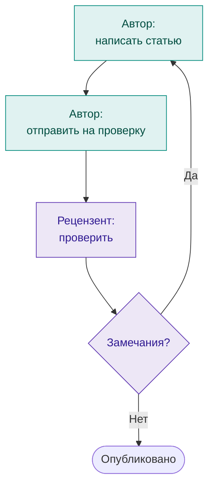

# О базе знаний

Для создания качественного программного продукта в срок и в рамках бюджета необходима система управления производством, 
которая преобразует разработку из творческого хаоса в актуализируемые, управляемые, предсказуемые и повторяемые процессы 
производства. Фундаментом такой системы управления являются знания и опыт работников компании.

База знаний создана как инструмент для накопления информации, необходимой для выстраивания процессов системы 
управления производством программных продуктов. 

База знаний используется также как "полигон" для исследования способов создания и ведения документации: порядков 
действий, требований к программному продукту, инструкций пользователя и других документов.

-   :lucide-book-open: **Глоссарий**

    Термины и определения, которые используются в базе знаний.

    [:octicons-arrow-right-24: Открыть](glossary.md#article-overview){ data-preview }

-   :lucide-lightbulb: **Архитектура базы знаний**

    Принципы, правила построения и ведения базы знаний.

    [:octicons-arrow-right-24: Открыть](kb-architecture/kb-concept.md#article-overview){ data-preview }

