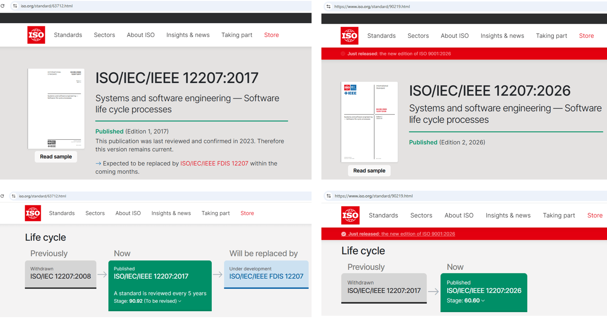

[О базе знаний][1] › [Структура базы знаний][2] › Библиография

# Библиография

## Структура статьи

- [Содержание статьи][4]
- [Порядок выбора стандарта][5]
- [Как читать описания стандартов][6]
- [Стандарты][7]
    - [ISO/IEC/IEEE 12207 (процессы жизненного цикла программного обеспечения)][8]
    - [Состояние ISO/IEC/IEEE 12207 на сайте ISO][9]
- [Литература][10]
    - [Вигерс, Битти: Разработка требований к программному обеспечению][11]
- [Связанные статьи][12]

## Содержание статьи

В статье собраны краткие описания стандартов и литературы, которые были изучены и хотя бы частично использованы при
создании системы управления производством программных продуктов. Статья пополняется по мере обработки новых источников.

Описания стандартов серии SQuaRE вынесены в отдельные статьи: [управление и модели качества][13],
[измерение качества][14], [требования и оценка качества][15]. В этой статье описан стандарт ISO/IEC/IEEE 12207 и книга
по разработке требований.

[*Переход вверх*][3]

## Порядок выбора стандарта

В части стандартов предпочтение отдано стандартам [ISO][16]. ISO создала большое количество стандартов, которые
регламентируют стороны управления производством программных продуктов. Для каждого стандарта ISO приведены региональные
аналоги (при их наличии и известности автору базы знаний). Порядок выбора стандарта:

1. Определить актуальную версию стандарта ISO по странице стандарта на сайте ISO.
2. Если компания находится в Беларуси и белорусский аналог существует, использовать белорусский аналог.
3. Если белорусского аналога нет, использовать российский аналог.
4. Если российского аналога нет, использовать стандарт ISO.

Дополнительные правила:

- **Аналог со статусом "устарел"**: Перед применением сверить аналог с актуальной версией ISO.  
  Причина: Статус означает, что национальный стандарт не соответствует актуальной версии ISO.
- **Ссылка на страницу ISO**: Для стандартов ISO указана ссылка на страницу стандарта на официальном сайте ISO.  
  Причина: На странице приведены сведения об актуальности стандарта и о планах на его замену.

[*Переход вверх*][3]

## Как читать описания стандартов

Описание каждого стандарта состоит из одинаковых полей:

- **Аннотация**: Краткое описание содержания стандарта.
- **Применение**: Области применения и круг пользователей стандарта.
- **Ограничения**: Что стандарт не определяет (поле заполнено не для всех стандартов).
- **ISO, Беларусь, Россия**: Обозначение и наименование стандарта в каждом источнике и соответствие стандарта версии
  ISO.
- **Соответствие ISO**: Значение "аналог" означает национальный стандарт, соответствующий версии ISO из записи. Значение
  "устарел" означает национальный стандарт, соответствующий более ранней версии ISO. Значение "отсутствует" означает,
  что национального аналога нет.

Аннотации стандартов подготовлены с помощью ИИ-ассистентов (запрос на аннотацию стандарта в один абзац, отдельный запрос
на белорусский и российский аналоги) и должны сверяться с первоисточником. Русские наименования стандартов ISO взяты из
каталога БелГИСС, например, со [страницы стандарта ISO/IEC 25021:2012][17]. Тексты российских стандартов доступны по
ссылкам "Текст стандарта".

[*Переход вверх*][3]

## Стандарты

Стандарты серии SQuaRE описаны в отдельных статьях (см. раздел "Содержание статьи"). Ниже описан стандарт процессов
жизненного цикла программного обеспечения.

### ISO/IEC/IEEE 12207 (процессы жизненного цикла программного обеспечения)

- **Аннотация**: Стандарт устанавливает общую структуру процессов жизненного цикла программного обеспечения:
  терминологию, процессы, действия и задачи, применимые при приобретении, поставке, разработке, эксплуатации,
  сопровождении и выводе из эксплуатации программных систем, продуктов и услуг. Охватывает весь жизненный цикл, от
  замысла до вывода из эксплуатации.
- **Применение**: Применим к уникальным, широко распространяемым, кастомизированным и адаптируемым программным системам,
  включая программную часть встроенного ПО и системы, встроенные в более крупные системы. Может применяться параллельно,
  итеративно и рекурсивно, в том числе в agile-подходах. Включает определение системы для контекста и процессы
  определения, контроля и улучшения процессов жизненного цикла в организации или проекте.
- **Ограничения**: Не предписывает конкретную модель жизненного цикла, методологию, метод или техники. Не детализирует
  информационные элементы (документацию): их содержание определено в ISO/IEC/IEEE 15289.
- **ISO**:
    - **Обозначение**: [ISO/IEC/IEEE 12207:2026][18]
    - **Наименование**: Systems and software engineering - Software life cycle processes
    - **Русское наименование**: Разработка систем и программного обеспечения. Процессы жизненного цикла программного
      обеспечения
- **Беларусь**:
    - **Обозначение**: СТБ ISO/IEC/IEEE 12207-2023
    - **Наименование**: Разработка систем и программного обеспечения. Процессы жизненного цикла программного обеспечения
    - **Соответствие ISO**: устарел
- **Россия**:
    - **Обозначение**: ГОСТ Р ИСО/МЭК 12207-2010
    - **Наименование**: Информационная технология. Системная и программная инженерия. Процессы жизненного цикла
      программных средств
    - **Соответствие ISO**: устарел

[*Переход вверх*][3]
### Состояние ISO/IEC/IEEE 12207 на сайте ISO

Состояние стандарта на сайте ISO показано на рисунке ниже:

*Рис.1 Информация о стандарте ISO/IEC/IEEE 12207 на официальном сайте ISO*

На скриншоте сравниваются страницы сайта ISO для версий ISO/IEC/IEEE 12207:2017 и 12207:2026. Версия 2017 года имеет
статус "Withdrawn" (отозвана). Актуальная версия 2026 года имеет статус "Now / Published" и находится на стадии 60.60.

[*Переход вверх*][3]

## Литература

Книги, изученные при создании системы управления производством программных продуктов:

### Вигерс, Битти: Разработка требований к программному обеспечению

- **Аннотация**: Книга описывает работу с требованиями к программному обеспечению: от первичного сбора до управления
  изменениями. Рассматривает типы требований (бизнес-, пользовательские, функциональные и нефункциональные), принципы их
  документирования в гибкой (Agile) и классической среде, способы проверки качества требований и управления изменениями.
  Содержит методы, шаблоны и чек-листы.
- **Для кого**: Бизнес-аналитики, системные аналитики, проектные менеджеры и другие участники создания программных
  продуктов.
- **Авторы**: Карл Вигерс, Джой Битти.
- **Издание**: Третье, дополненное.

[*Переход вверх*][3]

## Связанные статьи

Статьи базы знаний, которые дополняют библиографию:

- [Глоссарий][19] - определение термина ISO и других терминов базы знаний.
- [Структура базы знаний][2] - состав и иерархия статей базы знаний.

[*Переход вверх*][3]

[1]: <./README.md> ""
[2]: <./kb-structure.md> ""
[3]: <#библиография> ""
[4]: <#содержание-статьи> ""
[5]: <#порядок-выбора-стандарта> ""
[6]: <#как-читать-описания-стандартов> ""
[7]: <#стандарты> ""
[8]: <#isoiecieee-12207-процессы-жизненного-цикла-программного-обеспечения> ""
[9]: <#состояние-isoiecieee-12207-на-сайте-iso> ""
[10]: <#литература> ""
[11]: <#вигерс-битти-разработка-требований-к-программному-обеспечению> ""
[12]: <#связанные-статьи> ""
[13]: <./kb-square-models.md> ""
[14]: <./kb-square-measures.md> ""
[15]: <./kb-square-eval.md> ""
[16]: <./glossary.md#iso> ""
[17]: <https://shop.belgiss.by/ru/mezhdunarodnye-standarty-iso/iso-iec-25021:2012> ""
[18]: <https://www.iso.org/ru/standard/90219.html> ""
[19]: <./glossary.md> ""
