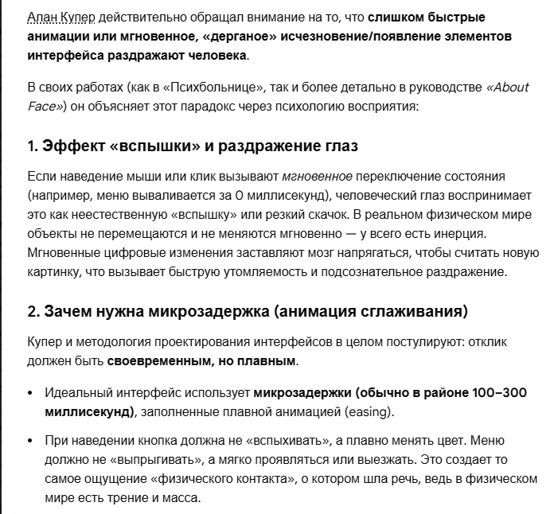
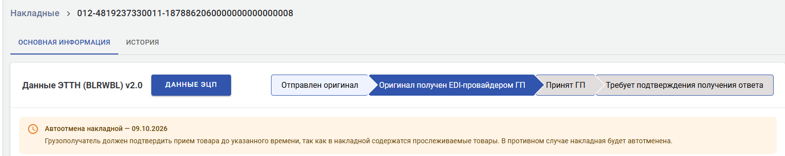
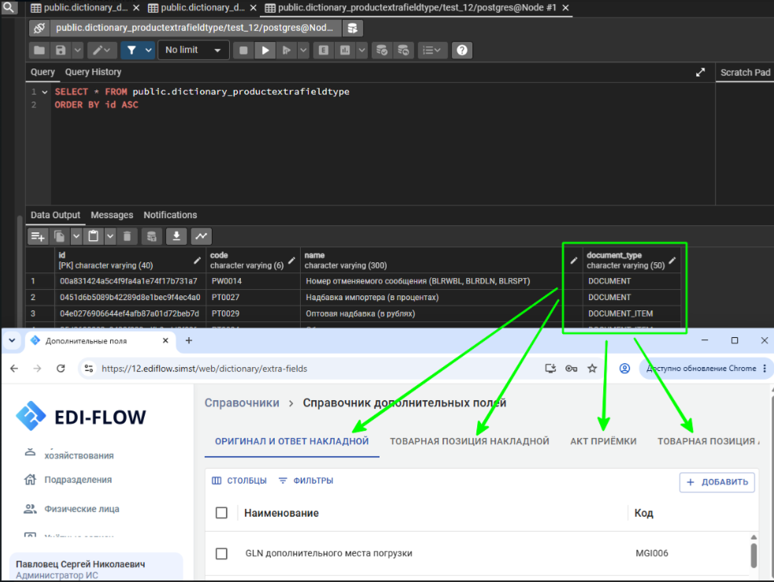

# Необработанные идеи 

## Содержание

- [Моё резюме][2]
- [Боли ИТ][3]
- [Лего-архитектура][4]
- [Тёмная фабрика][5]
- [Автотесты][3]
    - [Общие идеи по автотестам][13]
    - [Lego-архитектура автотестов][14]
- [Требования к ПО][7]
- [Стандарты ISO][8]
- [Демонстрация клиенту интерфейса ПО][9]
- [Тестирование удобства использования][10]
- [Требования к UI][11]
- [RAG][12]
- [База данных][13]

## Моё резюме

Так как я говорил о том, что я фактически аналитиком был - привести фрагменты моих инструкций...

[*Переход вверх*][1]

## Боли ИТ

- Отсутствие стандартизации работ: вроде бы всё знаем, а применяем лишь то, что удобно для текущего уровня развития 
конкретной команды. 
- Практически невозможно определить длительность выполнения работ (особенно с учётом текучки кадров). 
- Потеря/частичная потеря знаний по проекту при текучке кадров. 

[*Переход вверх*][1]

## Лего-архитектура

Чёрные ящики создаются людьми или человек + ИИ. Потом сборка из чётных ящиков: человеком или ИИ.

Я в README базы знаний сказал, что практически невозможно определить длительность проведения работ, учитывая текучку 
кадров. Что я предлагаю? Сквозное описание лего-компонентов: требования, код, автотесты (всех уровней). Можно вычислить, 
за сколько времени из готовых компонентов соберётся система, плюс-минус адаптация или  создание недостающих компонентов. 
Точность прогнозирования повышается в разы.

[*Переход вверх*][1]

## Тёмная фабрика

Так, генеративный ИИ позволил IT-отрасли начать движение в направлении создания "автоматизированной системы производства 
программных продуктов" - системы-оркестратора, в которой были бы объедены человек, ИИ, программный код (управляющие, 
контролирующие скрипты и т.п.), сторонние программные инструменты; которая охватывала бы все этапы жизненного цикла 
производства программного продукта. 

[*Переход вверх*][1]

## Автотесты

### Общие идеи по автотестам

В чем прелесть разработки автотестов программистами. Программист, зная код и правила тест-дизайна, сделает только 
необходимое количество тестов. Например, делаю автотесты на движение накладной между двумя СХ в рамках одного 
провайдера. Потом начинаю делать автотесты на движение накладной в рамках одного СХ в рамках одного 
провайдера (между разными подразделениями, в рамках одного подразделения). Я планирую на все эти комбинации отдельные 
тесты. Программист говорит - здесь один и тот же код. И движение в рамках одного СХ есть смысл проверить только на 
отображение накладных на вкладках Входящие/Исходящие (вот тут код написан не столь универсально).    
С другой стороны, если есть переиспользуемые компоненты, ничего страшного не будет, если такие автотесты сделать.  

Нужна фикстура, которая могла бы очистить БД (нужные таблицы). Но не всегда это целесообразно. То есть запускать ее 
нужно когда нужно.

 Нужны два вида автотестов: с нуля (пустая БД), есть данные (n-накладных). В обоих крайностях могут быть проблемы.

[*Переход вверх*][1] 

### Lego-архитектура автотестов

Мне на примере справочника стран сделать: описать требования, комбинаторику в AC (на базе тест-дизайна). Так же сделать 
"фреймворк", который будет содержать методы-пустышки с docstring, содержащих специальное описание. 
Далее промпт по AC сущности будет искать нужные методы и собирать из них текстовые файлы - автотесты. 
Этим самым я продемонстрирую концепцию создания ИИ автотестов на базе требований и lego-тестовых методов.

Lego-методы должны иметь возможность собираться как элементы конструктора в нужные комбинации, согласно требованиям AC. 
Следовательно, в AC должны содержаться и сценарии. 

[*Переход вверх*][1]

## Требования к ПО

Описание БД (всех таблиц и полей) в требованиях делать бессмысленно. Оптимально иметь такой раздел, ссылающийся на 
соответствующий файл репозитория (где программисты описывают БД). А вот от программистов потребовать описание таблиц и 
полей определенного шаблона и это контролировать: Для чего таблица, для чего каждое поле, какие методы используются для 
генерации значений поля, для извлечения значений поля. Продумать это. 

!!! Важно. Я про SRS знаю, а вот SDD нужно сделать.
Этап SDLC               Создаваемый официальный документ
Анализ требований       SRS (Software Requirements Specification) — ТЗ и спецификация требований.
Проектирование          SDD (Software Design Document) — архитектурный дизайн системы.
Разработка              Документированный код, API-документация (Swagger/Postman), Deployment Guide.
Тестирование            Test Plan (план тестирования) и Test Cases (тест-кейсы).

**Это в рамках системного анализа!!!!**
Программист сделал подписку на события: изменения в таблице! То есть добавилась запись, фронту пришло событие и он 
обновил таблицу (еще что-то сделал):
вебсокет соединение
ты подписываешься на изменения таблицы
если кто-то меняют состояние таблицы (добавляет, изменяет, удаляет запись)
по вебсокетам подключенным клиентам приходит об этом сигнал
и соответственно без перезапросов, у пользователя сразу обновляется UI

[*Переход вверх*][1]

## Стандарты ISO

!!!! использование стандарта для измерения удобства использования по **ISO 9241-11**

[*Переход вверх*][1]

## Демонстрация клиенту интерфейса ПО

- Разработка на Figma, так как аналитик не понимает на чем могут реализовывать UI.
- Перед демонстрацией клиенту - перенос уже в React, так как клиент уже видит не картинки, а реально работающий интерфейс. 
- Демонстрация должна происходить как можно раньше. После утверждения бизнес-процессов Клиентом. 
- У клиента должен быть доступ к этому стенду, чтобы сами могли зайти в спокойной обстановке. 
- Я про окошки фильтрации и настройки столбцов - очень быстро пропадают после нажатия соответствующих кнопок. Ну и 
вообще про остальное (дальнейший интерфейс). 

[*Переход вверх*][1]

## Тестирование удобства использования

Это важно делать перед первой демонстрацией интерфейса клиенту.

- Контроль использования в новом интерфейсе всех элементов, которые признаны эффективными на других страницах/приложениях. 
- Контроль единства стилистики: в одном месте овальные кнопки, в другом - квадратные; единая цветовая гамма для аналогичных элементов.
- Удобство расположения элементов: больше правшей, группировка (расположение близко друг к другу) элементов одной функциональности.
- Общее первое впечатление как пользователя. Первое впечатление - самое верное. При дальнейшем изучении интерфейса уже можно не увидеть, что не устраивает. 
- Вообще мне создать такой алгоритм полный такого тестирования.

[*Переход вверх*][1]

## Требования к UI

- На скриншоте показан алерт об автоотмене.  Он оранжевого цвета (замена жёлтого, так как жёлтый не контрастный). В 
приложении реализована концепция "светофора": критические сообщения - красные, предупреждения - оранжевые, 
подтверждающие - зелёные.
 

[*Переход вверх*][1]

## RAG

Вот 4 варианта перефразирования под разные стратегии индексации (выберите ту, которая используется в вашей архитектуре):
1. **Плотный семантический вариант (Оптимально для Vector Search)**
Этот вариант убирает вводные слова («Статья определяет...») и сразу связывает проблему с решением, что повышает точность 
совпадения векторов.
Концепция управления личными и корпоративными базами знаний в условиях избытка ИИ-контента основана на 
итеративно-инкрементальном подходе и обязательной экспертной верификации информации человеком для сохранения ее ценности 
и актуальности.
2. **Ключевые слова и теги (Для гибридного поиска / Hybrid Search с BM25)**
Если в вашей RAG-системе используется связка векторного поиска и ключевых слов, этот вариант сработает эффективнее 
всего.
Создание, наполнение и развитие баз знаний (личных и корпоративных) при избытке контента от искусственного интеллекта. 
Методология: итеративно-инкрементальный подход, экспертная проверка человеком, верификация данных, сохранение актуальности и ценности информации.
3. **Вопросно-ответный формат (Для стратегии Query-Passage / FAQ)**
Если пользователи часто задают вопросы к базе знаний, этот блок идеален для точного мэтчинга с вопросом юзера.
Вопрос: Как создавать и развивать личные или корпоративные базы знаний в условиях избытка контента от ИИ?
Ответ: Использовать итеративно-инкрементальный подход и внедрить обязательную экспертную проверку информации человеком 
для сохранения ее ценности и актуальности.
4. **Максимально сжатый (Для экономии контекстного окна / Summary Chunk)**
Убирает всё лишнее, оставляя только жесткие факты для LLM на этапе генерации.
Развитие баз знаний при избытке ИИ-контента базируется на пошаговом (итеративно-инкрементальном) подходе и ручной 
экспертной проверке человеком для защиты ценности данных.
Подскажите, какую модель эмбеддингов (например, OpenAI, Cohere, BGE) или векторную БД вы используете? Я могу 
адаптировать текст под конкретную длину чанка (chunk size).

[*Переход вверх*][1]

## База данных

Если в справочнике значения разнесены по вкладкам, оптимально в БД сделать столбец `type`, чтобы фронт понимал, на какую 
вкладку выводить значение.

[1]: #необработанные-идеи
[2]: #моё-резюме
[3]: #боли-ит
[4]: #лего-архитектура
[5]: #тёмная-фабрика
[6]: #автотесты
[7]: #требования-к-по
[8]: #стандарты-iso
[9]: #демонстрация-клиенту-интерфейса-по
[10]: #тестирование-удобства-использования
[11]: #требования-к-ui
[12]: #rag
[13]: #общие-идеи-по-автотестам
[14]: #lego-архитектура-автотестов
[15]: 