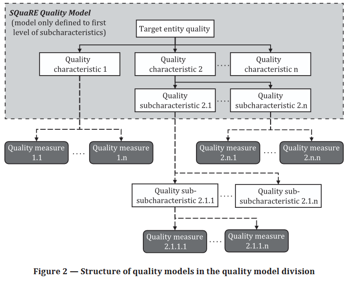
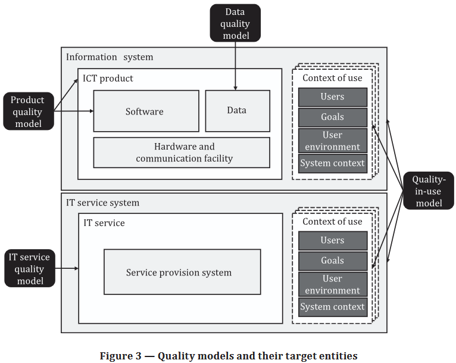
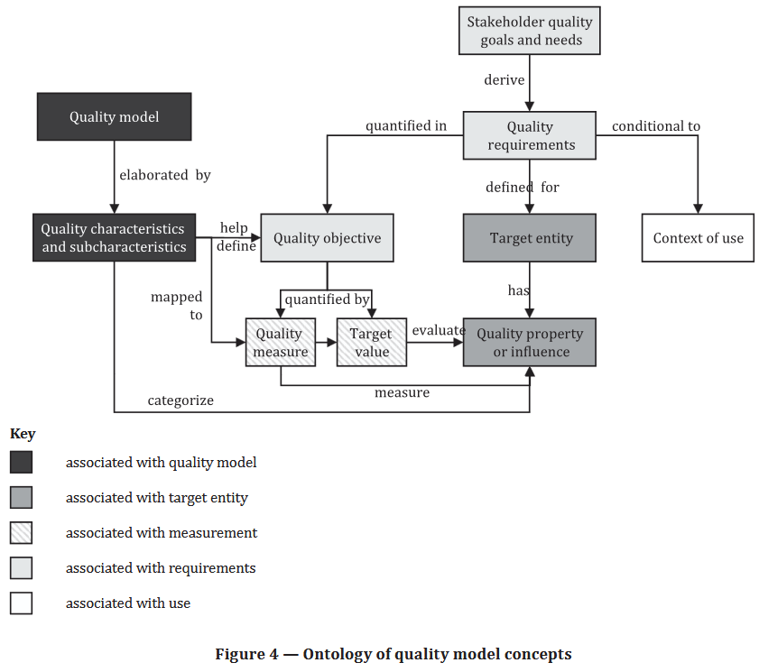

# Стандарты
!!!!! https://www.perplexity.ai/
https://zenodo.org/records/14758339
https://www.sonarsource.com/resources/library/iso-iec-25010-explained/

- ISO/IEC 25000:2014. Systems and software engineering — Systems and software Quality Requirements and Evaluation 
(SQuaRE) — Guide to SQuaRE
    - Системная и программная инженерия — Требования к качеству и оценка программного обеспечения (SQuaRE) — Руководство 
    по SQuaRE
    - Данная публикация в последний раз пересматривалась и подтверждалась в 2026 году. Поэтому эта версия остается 
    актуальной.
    - **ISO/IEC 25000:2005 -> ISO/IEC 25000:2014 (этап 90.93, подтверждено)**
    - https://www.iso.org/standard/64764.html#lifecycle
    - Status: Published
    - Publication date: 2014-03
    - Stage: International Standard confirmed [90.93 от 08.01.2026]
    - Edition: 2
    - Number of pages: 27
    - Abstract: 
        ISO/IEC 25000:2014 содержит рекомендации по использованию новой серии международных стандартов под названием 
        «Требования к качеству систем и программного обеспечения и их оценка» (SQuaRE). Цель ISO/IEC 25000:2014 — 
        предоставить общий обзор содержания SQuaRE, общих эталонных моделей и определений, а также взаимосвязи между 
        документами, что позволит пользователям данного руководства хорошо понимать эти серии стандартов в соответствии 
        с их назначением. В нем также содержится объяснение процесса перехода между старым стандартом ISO/IEC 9126 и 
        серией ISO/IEC 14598 и SQuaRE.

- ISO/IEC 25001:2014. Systems and software engineering — Systems and software Quality Requirements and Evaluation 
(SQuaRE) — Planning and management
    - Системная и программная инженерия — Требования к качеству и оценка качества систем и программного обеспечения 
    (SQuaRE) — Планирование и управление
    - Данная публикация в последний раз пересматривалась и подтверждалась в 2026 году. Поэтому эта версия остается 
    актуальной.
    **ISO/IEC 25001:2007 -> ISO/IEC 25001:2014 (этап 90.93, подтверждено)**
    - https://www.iso.org/standard/64787.html
    - Status: Published
    - Publication date: 2014-03
    - Stage: International Standard confirmed [90.93 от 08.01.2026]
    - Edition: 2
    - Number of pages: 13
    - Abstract: 
        Стандарт ISO/IEC 25001:2014 содержит требования и рекомендации для организации, ответственной за внедрение и 
        управление деятельностью по определению и оценке требований к качеству систем и программных продуктов 
        посредством предоставления технологий, инструментов, опыта и управленческих навыков.
        В обязанности оценочной группы входит мотивация сотрудников и их обучение по вопросам спецификации требований и 
        оценочной деятельности, подготовка соответствующей документации, определение или разработка необходимых методов, 
        а также ответы на вопросы, касающиеся соответствующих технологий.

        Управление технологиями связано с планированием и управлением процессом определения требований к качеству систем 
        и программного обеспечения, а также процессом оценки, измерениями и инструментами. Это включает в себя 
        управление разработкой, приобретением, стандартизацией, контролем, передачей и обратной связью по опыту в 
        области определения требований и оценки технологий внутри организации.

        Целевыми пользователями стандарта ISO/IEC 25001:2014 являются лица, ответственные за:

        - управление технологиями, используемыми для определения требований и выполнения оценки;
        - определение требований к качеству систем и программных продуктов;
        - оценка качества вспомогательных систем и программных продуктов;
        - управление организациями, занимающимися разработкой систем и программного обеспечения,
        а также для тех, кто работает в сфере обеспечения качества. Однако это также применимо к менеджерам, 
        занимающимся другими видами деятельности, связанными с системами или программным обеспечением.

- ISO/IEC 25002:2024. Systems and software engineering — Systems and software Quality Requirements and Evaluation 
(SQuaRE) — Quality model overview and usage
    - Системная и программная инженерия — Требования к качеству и оценка качества систем и программного обеспечения 
    (SQuaRE) — Обзор и использование модели качества
    - https://www.iso.org/standard/78175.html
    - **ISO/IEC 25010:2011 -> ISO/IEC 25002:2024 (этап 60.60)**
    - Status: Published
    - Publication date: 2024-03
    - Stage: International Standard published [60.60 от 04.03.2024]
    - Edition: 1
    - Number of pages: 17
    - Abstract: 
        Настоящий документ устанавливает основу для определения моделей качества, состоящих из характеристик и 
        подхарактеристик качества. В частности, настоящий документ предусматривает:
        - концепция модели качества;
        - структура и семантика моделей качества;
        - взаимосвязь между моделями качества и другими понятиями, включая измерение, определение требований и оценку;
        - руководящие принципы, требования и примеры использования моделей качества.

- ISO/IEC 25010:2023. Systems and software engineering — Systems and software Quality Requirements and Evaluation 
(SQuaRE) — Product quality model
    - Системная и программная инженерия — Требования к качеству систем и программного обеспечения и их оценка (SQuaRE) — 
    Модель качества продукта
    - **ISO/IEC 25010:2011 -> ISO/IEC 25010:2023 (этап 60.60)**
    - Status: Published
    - Publication date: 2023-11
    - Stage: International Standard published [60.60 от 15.11.2023]
    - Edition: 2
    - Number of pages: 22
    - Abstract: 
        В данном документе определена модель качества продукции, применимая к продуктам ИКТ 
        (информационно-коммуникационных технологий) и программным продуктам. Модель качества продукции состоит из девяти 
        характеристик (которые далее подразделяются на подхарактеристики), относящихся к качественным свойствам 
        продукции. Характеристики и подхарактеристики представляют собой эталонную модель для определения, измерения и 
        оценки качества продукции.

        ПРИМЕЧАНИЕ 1. В данном документе под продуктом понимается ИКТ-продукт, являющийся частью информационной системы. 
        Компоненты ИКТ-продукта включают подсистемы, программное обеспечение, микропрограммы, аппаратное обеспечение, 
        данные, коммуникационную инфраструктуру и другие элементы, входящие в состав ИКТ-продукта.

        Данная модель может использоваться для определения требований и оценки качества целевых продуктов на протяжении 
        всего их жизненного цикла различными заинтересованными сторонами, включая разработчиков, заказчиков, сотрудников 
        отдела обеспечения и контроля качества, а также независимых экспертов. К числу мероприятий в жизненном цикле 
        продукта, которые могут выиграть от использования этой модели, относятся:
        - выявление и определение требований к продукту и информационной системе;
        - проверка полноты определения требований;
        - определение целей проектирования продукта и информационной системы, а также разработка необходимых процессов 
        для достижения качества;
        - определение целей тестирования продукта и информационной системы;
        - определение критериев контроля качества как части обеспечения качества;
        - определение критериев приемки продукта и/или информационной системы;
        - установление показателей качества продукции в поддержку этих мероприятий.
       
       ПРИМЕЧАНИЕ 2. Использование модели качества для измерения объяснено в Приложении C.

- ISO/IEC TS 25011:2017. Information technology — Systems and software Quality Requirements and Evaluation (SQuaRE) — Service quality models
    - Информационные технологии — Требования к качеству систем и программного обеспечения и их оценка (SQuaRE) — Модели качества обслуживания
    - Данная публикация в последний раз пересматривалась и подтверждалась в 2024 году. Поэтому эта версия остается актуальной.
    - https://www.iso.org/standard/35735.html

- ISO/IEC 25012:2008. Software engineering — Software product Quality Requirements and Evaluation (SQuaRE) — Data quality model
    - Разработка программного обеспечения — Требования к качеству и оценка программного продукта (SQuaRE) — Модель качества данных
    - https://www.iso.org/standard/35736.html

- ISO/IEC 25019:2023. Systems and software engineering — Systems and software Quality Requirements and Evaluation (SQuaRE) — Quality-in-use model
    - Системная и программная инженерия — Требования к качеству и оценка качества систем и программного обеспечения (SQuaRE) — Модель качества в процессе использования
    - https://www.iso.org/standard/78177.html
    - **ISO/IEC 25010:2011 -> ISO/IEC 25019:2023 (этап 60.60 от 24.11.2023)**

- ISO/IEC 25020:2019. Systems and software engineering — Systems and software Quality Requirements and Evaluation (SQuaRE) — Quality measurement framework
    - Системная и программная инженерия — Требования к качеству и оценка качества систем и программного обеспечения (SQuaRE) — Система измерения качества
    - Данная публикация в последний раз пересматривалась и подтверждалась в 2025 году. Поэтому эта версия остается актуальной.
    - https://www.iso.org/standard/72117.html
    - **ISO/IEC 25020:2007 -> ISO/IEC 25020:2019 (этап 90,93 от 03.01.2025, подтверждено)**

- ISO/IEC 25021:2012. Systems and software engineering — Systems and software Quality Requirements and Evaluation (SQuaRE) — Quality measure elements
    - Системная и программная инженерия — Требования к качеству и оценка качества систем и программного обеспечения (SQuaRE) — Элементы измерения качества
    - https://www.iso.org/standard/55477.html
    - Данная публикация в последний раз пересматривалась и подтверждалась в 2024 году. Поэтому эта версия остается актуальной.
    - **ISO/IEC TR 25021:2007 -> ISO/IEC 25021:2012 (этап 90,93 от 09.08.2024, подтверждено)**

- ISO/IEC 25022:2016. Systems and software engineering — Systems and software quality requirements and evaluation (SQuaRE) — Measurement of quality in use 
    - Системная и программная инженерия — Требования к качеству систем и программного обеспечения и их оценка (SQuaRE) — Измерение качества в процессе использования
    - Данная публикация в последний раз пересматривалась и подтверждалась в 2022 году. Поэтому эта версия остается актуальной.
    - https://www.iso.org/standard/35746.html
    - **ISO/IEC TR 9126-4:2004 -> ISO/IEC 25022:2016 (этап 90,92, подлежит замене)**

- ISO/IEC 25023:2016. Systems and software engineering — Systems and software Quality Requirements and Evaluation (SQuaRE) — Measurement of system and software product quality
    - Системная и программная инженерия — Требования к качеству систем и программного обеспечения и их оценка (SQuaRE) — Измерение качества системных и программных продуктов
    - Данная публикация в последний раз пересматривалась и подтверждалась в 2022 году. Поэтому эта версия остается актуальной.
    - https://www.iso.org/standard/35747.html
    - **ISO/IEC TR 9126-2:2003 + ISO/IEC TR 9126-3:2003 -> ISO/IEC 25023:2016 (подлежит замене)**

- ISO/IEC 25024:2015. Systems and software engineering — Systems and software Quality Requirements and Evaluation (SQuaRE) — Measurement of data quality
    - Системная и программная инженерия — Требования к качеству систем и программного обеспечения и их оценка (SQuaRE) — Измерение качества данных
    - Данная публикация в последний раз пересматривалась и подтверждалась в 2022 году. Поэтому эта версия остается актуальной.
    - https://www.iso.org/standard/35749.html 

- ISO/IEC TS 25025:2021. Information technology — Systems and software Quality Requirements and Evaluation (SQuaRE) — Measurement of IT service quality
    - Информационные технологии — Требования к качеству систем и программного обеспечения и их оценка (SQuaRE) — Измерение качества ИТ-услуг
    - Данная публикация в последний раз пересматривалась и подтверждалась в 2024 году. Поэтому эта версия остается актуальной.
    - https://www.iso.org/standard/74569.html

- ISO/IEC 25030:2019. Systems and software engineering — Systems and software quality requirements and evaluation (SQuaRE) — Quality requirements framework 
    - Системная и программная инженерия — Требования к качеству систем и программного обеспечения и их оценка (SQuaRE) — Структура требований к качеству
    - Данная публикация в последний раз пересматривалась и подтверждалась в 2025 году. Поэтому эта версия остается актуальной.
    - https://www.iso.org/standard/72116.html
    - **ISO/IEC 25030:2007 -> ISO/IEC 25030:2019 (подтверждено)**

    

- ISO/IEC 25040:2024. Systems and software engineering — Systems and software Quality Requirements and Evaluation (SQuaRE) — Quality evaluation framework
    - Системная и программная инженерия — Требования к качеству и оценка качества систем и программного обеспечения (SQuaRE) — Структура оценки качества
    - https://www.iso.org/ru/standard/83467.html
    - **ISO/IEC 25040:2011 -> ISO/IEC 25040:2024**

- ISO/IEC 25041:2012. Systems and software engineering — Systems and software Quality Requirements and Evaluation (SQuaRE) — Evaluation guide for developers, acquirers and independent evaluators
    - Системная и программная инженерия — Требования к качеству и оценка систем и программного обеспечения (SQuaRE) — Руководство по оценке для разработчиков, заказчиков и независимых экспертов
    - Последний раз этот публикация был пересмотрен в  2024. Поэтому данная версия остается актуальной.
    - https://www.iso.org/ru/standard/35766.html
    - **ISO/IEC 14598-3:2000 + ISO/IEC 14598-4:1999 + ISO/IEC 14598-5:1998 -> ISO/IEC 25041:2012 (подтверждено)**

- ISO/IEC 25045:2010. Systems and software engineering — Systems and software Quality Requirements and Evaluation (SQuaRE) — Evaluation module for recoverability
    - Системная и программная инженерия — Требования к качеству и оценка программного обеспечения (SQuaRE) — Модуль оценки восстанавливаемости
    - Последний раз этот публикация был пересмотрен в  2024. Поэтому данная версия остается актуальной.
    - https://www.iso.org/ru/standard/35770.html

- ISO/IEC 25051:2014. Software engineering — Systems and software Quality Requirements and Evaluation (SQuaRE) — Requirements for quality of Ready to Use Software Product (RUSP) and instructions for testing
    - Разработка программного обеспечения — Требования к качеству систем и программного обеспечения и их оценка (SQuaRE) — Требования к качеству готового к использованию программного продукта (RUSP) и инструкции по тестированию
    - Последний раз этот публикация был пересмотрен в  2026. Поэтому данная версия остается актуальной.
    - https://www.iso.org/ru/standard/61579.html
    - **ISO/IEC 25051:2006 + ISO/IEC 25051:2006/Cor 1:2007 -> ISO/IEC 25051:2014 (подтверждено)**

- ISO/IEC TS 25052-1:2022. Systems and software engineering — Systems and software Quality Requirements and Evaluation (SQuaRE): cloud services
Part 1: Quality model
    - Системная и программная инженерия — Требования к качеству и оценка программного обеспечения (SQuaRE): облачные сервисы
Часть 1: Модель качества
    - Последний раз этот публикация был пересмотрен в  2026. Поэтому данная версия остается актуальной.
    - https://www.iso.org/ru/standard/81467.html

- ISO/IEC TS 25052-2:2024. Systems and software engineering — Systems and software Quality Requirements and Evaluation (SQuaRE): cloud services
Part 2: Quality measurement
    - Системная и программная инженерия — Требования к качеству и оценка программного обеспечения (SQuaRE): облачные сервисы
Часть 2: Измерение качества
    - https://www.iso.org/ru/standard/86722.html

- ISO/IEC TS 25058:2024. Systems and software engineering — Systems and software Quality Requirements and Evaluation (SQuaRE) — Guidance for quality evaluation of artificial intelligence (AI) systems
    - Системная и программная инженерия — Требования к качеству и оценка систем и программного обеспечения (SQuaRE) — Руководство по оценке качества систем искусственного интеллекта (ИИ)
    - https://www.iso.org/ru/standard/82570.html
    - ждет замены

- ISO/IEC AWI 25058. Systems and software engineering — Systems and software Quality Requirements and Evaluation (SQuaRE) — Measurement and guidance for quality evaluation of AI systems
    - Системная и программная инженерия — Требования к качеству и оценка систем и программного обеспечения (SQuaRE) — Измерение и рекомендации по оценке качества систем искусственного интеллекта
    - https://www.iso.org/ru/standard/91881.html
    - в стадии разработки

- ISO/IEC 25059:2023. Software engineering — Systems and software Quality Requirements and Evaluation (SQuaRE) — Quality model for AI systems
    - Разработка программного обеспечения — Требования к качеству систем и программного обеспечения и их оценка (SQuaRE) — Модель качества для систем искусственного интеллекта
    - https://www.iso.org/ru/standard/80655.html
    - В ближайшие месяцы ожидается замена на ISO/IEC FDIS 25059

- ISO/IEC FDIS 25059. Software engineering — Systems and software Quality Requirements and Evaluation (SQuaRE) — Quality models for AI systems
    - Разработка программного обеспечения — Требования к качеству систем и программного обеспечения и их оценка (SQuaRE) — Модели качества для систем искусственного интеллекта
    - https://www.iso.org/ru/standard/88234.html
    - в стадии разработки

- ISO/TR 25060:2023
Systems and software engineering — Systems and software Quality Requirements and Evaluation (SQuaRE) — General framework for Common Industry Format (CIF) for usability-related information
    - Системная и программная инженерия — Требования к качеству и оценка систем и программного обеспечения (SQuaRE) — Общая структура для общего отраслевого формата (CIF) для информации, связанной с удобством использования
    - https://www.iso.org/ru/standard/83763.html

- ISO 25062:2025. Systems and software engineering — Systems and software Quality Requirements and Evaluation (SQuaRE) — Common Industry Format (CIF) for reporting usability evaluations
    - Системная и программная инженерия — Требования к качеству и оценка систем и программного обеспечения (SQuaRE) — Общий отраслевой формат (CIF) для отчетности по результатам оценки удобства использования
    - https://www.iso.org/ru/standard/84255.html

- ISO/IEC 25063:2014. Systems and software engineering — Systems and software product Quality Requirements and Evaluation (SQuaRE) — Common Industry Format (CIF) for usability: Context of use description
    - Системная и программная инженерия — Требования к качеству и оценка программных продуктов (SQuaRE) — Общий отраслевой формат (CIF) для удобства использования: описание контекста использования
    - https://www.iso.org/ru/standard/35789.html

- ISO/FDIS 25063. Systems and software engineering — Systems and software product Quality Requirements and Evaluation (SQuaRE) — Common Industry Format (CIF) for usability: Context of use description
    - Системная и программная инженерия — Требования к качеству и оценка программных продуктов (SQuaRE) — Общий отраслевой формат (CIF) для удобства использования: описание контекста использования
    - https://www.iso.org/ru/standard/89184.html
    - в стадии разработки

- ISO/IEC 25064:2013. Systems and software engineering — Software product Quality Requirements and Evaluation (SQuaRE) — Common Industry Format (CIF) for usability: User needs report
    - Системная и программная инженерия — Требования к качеству и оценка программного продукта (SQuaRE) — Общий отраслевой формат (CIF) для удобства использования: отчет о потребностях пользователей
    - https://www.iso.org/ru/standard/35790.html

- ISO 25065:2019. Systems and software engineering — Software product Quality Requirements and Evaluation (SQuaRE) — Common Industry Format (CIF) for Usability: User requirements specification
    - Системная и программная инженерия — Требования к качеству и оценка программных продуктов (SQuaRE) — Общий отраслевой формат (CIF) для удобства использования: спецификация требований пользователя
    - Последний раз этот публикация был пересмотрен в  2024. Поэтому данная версия остается актуальной.
    - https://www.iso.org/ru/standard/72189.html

- ISO/CD 25067
Systems and software engineering — Software product quality Requirements and Evaluation (SQuaRE) — Common Industry Format (CIF) for Usability: Design specification of user-system interaction and user interface
    - Системная и программная инженерия — Требования и оценка качества программных продуктов (SQuaRE) — Общий отраслевой формат (CIF) для удобства использования: Спецификация проектирования взаимодействия пользователя с системой и пользовательского интерфейса
    - в процессе разработки
    - https://www.iso.org/ru/standard/87661.html

# ISO/IEC 25002:2024
## 6. Обзор модели качества
Модель качества представляет собой определенный набор характеристик и подхарактеристик, оцениваемых количественно с 
помощью показателей качества; она может использоваться для формулирования требований к качеству и оценки свойств 
качества целевых объектов. 

Каждая модель качества служит основой для определения требований к качеству и измерения возможностей целевого объекта. 
Модели качества серии SQuaRE разработаны для применения к любым типам целевых объектов и для любых заинтересованных 
сторон. 

В этих моделях свойства качества целевых объектов классифицируются по различным характеристикам и подхарактеристикам, 
которые можно ранжировать по приоритетности, определять, измерять, оценивать и которыми можно управлять в интересах 
различных заинтересованных сторон. 

Характеристики качества могут служить ориентиром при определении требований к качеству, вытекающих из потребностей и 
целей заинтересованных сторон.

Модели качества, входящие в соответствующий раздел, позволяют проводить как количественную, так и качественную оценку 
целевых объектов и предоставлять обратную связь заинтересованным сторонам из сферы бизнеса и ИТ. 

Модели качества используются для формулирования требований к качеству (раздел «Требования к качеству»), установления 
показателей качества (раздел «Измерение качества») и проведения оценки качества (раздел «Оценка качества»).

Модели качества включают характеристики и подхарактеристики, связанные со свойствами качества целевых объектов. Таким 
образом, **характеристики качества в этих моделях могут использоваться для разработки контрольных списков**, 
**обеспечивающих всестороннюю проверку выполнения требований к качеству**. **Результаты такой оценки служат обратной** 
**связью для процессов разработки, интеграции, сопровождения и других этапов жизненного цикла системы.**

Модели качества применимы к целевым объектам, которые разрабатываются «с нуля», приобретаются в готовом виде, 
адаптируются на базе систем поставщиков, интегрируются из решений с открытым исходным кодом, а также к объектам, 
находящимся в эксплуатации и требующим технического обслуживания или модернизации. 

Модели качества не зависят от методов разработки, поскольку они применимы к свойствам качества любых ИКТ-продуктов и 
ИТ-услуг. 

Следовательно, **показатели характеристик и подхарактеристик качества помогают количественно оценить степень** 
**удовлетворения потребностей и требований заинтересованных сторон** для широкого спектра ИКТ-систем и ИТ-услуг. При 
использовании в отношении эксплуатируемых целевых объектов **показатели, полученные на основе моделей качества,** 
**позволяют количественно оценить влияние этих объектов на заинтересованные стороны.**

## 7.1. Структура модели качества
Модели качества SQuaRE в семействе стандартов SQuaRE обладают следующими структурными атрибутами.
- Модель качества состоит из набора характеристик качества, которые в совокупности охватывают измеримые свойства 
качества целевого объекта.
- Когда количество или сложность атрибутов характеристики качества оправдывают это, характеристика качества разделяется 
на набор подхарактеристик качества, которые в совокупности охватывают диапазон атрибутов качества, обычно связанных с 
этой характеристикой качества.
- Подхарактеристики качества, связанные с характеристиками качества, имеющими отношение к целевому объекту, в 
совокупности охватывают полный набор измеримых свойств качества, имеющих отношение к целевому объекту.
- Насколько это возможно, подхарактеристики качества связаны с показателями, которые являются взаимоисключающими при 
количественной оценке свойств качества целевого объекта.
- Каждая характеристика или подхарактеристика качества связана с одной или несколькими мерами качества, определение и 
расчет которых описаны в разделе «Измерение качества».

В некоторых случаях подхарактеристику может потребоваться представить с более высокой степенью детализации, чтобы ее 
можно было применить в конкретный контекст использования. В таких случаях подхарактеристика может быть подразделена на 
подподхарактеристики.

Качественные характеристики можно разложить на одну или несколько подхарактеристик, каждая из которых может измеряться 
одним или несколькими показателями качества. Например, качественные характеристики продуктов ИКТ могут быть 
количественно измеряется с помощью показателей качества, связанных с качественными характеристиками и 
подхарактеристиками, связанными с требованиями заинтересованных сторон.

Могут возникать компромиссы, когда включение одной характеристики качества влияет на другую, например, негативное 
влияние на удобство использования из-за повышения безопасности или негативное влияние на ремонтопригодность из-за 
увеличения сложности, часто являющегося результатом проектирования программного обеспечения с целью повышения 
производительности.

**Качественные характеристики и субхарактеристики связаны с показателями качества, которые используются для оценки** 
**способности системы определять, соответствует ли она требованиям качества.** 

Пользователи качественных моделей и их показателей должны определять взаимосвязи и выстраивать прослеживаемость от 
качественных характеристик, субхарактеристик и показателей к качественным свойствам оцениваемого целевого объекта. Эта
прослеживаемость позволяет другим заинтересованным сторонам понимать, как оценивался целевой объект и как
интерпретировать количественные результаты. 

Качественные модели могут быть модифицированы или адаптированы на уровне субхарактеристик (но не на уровне 
характеристик) для применения в конкретном контексте использования.

## 7.2 Категории моделей качества
Существуют две основные перспективы качества:
- качество ИКТ-продукта, данных или ИТ-услуг, необходимых для удовлетворения потребностей заинтересованных сторон 
(например, безопасность ИКТ-продукта);
- качество использования, влияющее на пользователей или других заинтересованных сторон в конкретном контексте 
использования (например, удовлетворенность взаимодействием).

На качество ИКТ-продукта влияет качество его подсистем и компонентов. Программные или микропрограммные компоненты 
ИКТ-продукта имеют схожие характеристики качества с общим ИКТ-продуктом.

Хотя качество данных влияет на качество ИКТ-продуктов, модель качества данных определяется другим набором характеристик 
качества, чем у ИКТ-продуктов. 

Поэтому необходимы несколько моделей качества, для учета различных факторов, влияющих на качество информационных систем 
и ИКТ-продуктов. 

- Модель качества использования (ISO/IEC 25019) включает характеристики качества, описывающие влияние информационной 
системы на пользователей или других заинтересованных сторон в конкретном контексте использования.

- Модель качества продукта (ISO/IEC 25010) включает набор характеристик качества для ИКТ-продукта, включающего его 
программные, аппаратные и коммуникационные компоненты, которые определяют требования, спецификации, разработки и оценки 
ИКТ-продукта.

- Модель качества данных (ISO/IEC 25012) включает набор характеристик качества данных и технологий, управляющих данными, 
которые определяют требования, разработку и оценку данных.

- Модель качества ИТ-услуг (ISO/IEC TS 25011) включает набор характеристик качества ИТ-услуг, которые определяют 
требования, предоставление и оценку ИТ-услуг.

— Модель качества в процессе использования (ISO/IEC 25019) включает характеристики качества, связанные с поведенческими
атрибутами ИКТ-продукта или ИТ-услуги во время использования.

На рисунке 3 показано, как различные модели качества применяются к различным компонентам информационной системы или
системы ИТ-услуг. Модели качества в совокупности служат основой для обеспечения учета всех соответствующих аспектов
качества при определении требований, разработке или оценке информационных систем, ИКТ-продуктов, данных или ИТ-услуг. 

Однако приоритеты, присвоенные характеристикам качества в каждой модели, зависят от контекста использования 
информационной системы. Контекст использования представляет собой совокупность взаимодействующих факторов, включая:
- пользователей: типы людей, которые будут использовать систему;
- цели: намерения пользователей достичь, используя систему;
- пользовательскую среду: ситуацию, в которой пользователи используют систему;
- системный контекст: характер и технический контекст используемой системы.

ПРИМЕЧАНИЕ 1. Стрелками указаны целевые объекты в информационных системах или ИТ-услугах, к которым применяются модели 
качества SQuaRE.
ПРИМЕЧАНИЕ 2. Если ИТ-услуга не содержит ИКТ-продукт и его компоненты, ИТ-услуга может оцениваться отдельно от них.
ПРИМЕЧАНИЕ 3. Модель качества продукта косвенно применяется к аппаратному обеспечению и средствам связи, когда они 
являются компонентом ИКТ-продукта.
ПРИМЕЧАНИЕ 4. Система предоставления услуг — это информационная система для предоставления ИТ-услуг пользователям, 
включая персонал, процессы, технологии, оборудование и информацию.

## 7.3. Онтология концепций моделей качества
Как показано на рисунке 4, модели качества позиционируются в онтологии для представления концепций качества,
относящихся к целевому объекту (ИТ-продукту, данным или ИТ-услуге) и его влиянию на опыт заинтересованных сторон 
(качество в использовании). 

Модели качества строятся на основе характеристик и подхарактеристик качества, которые помогают определить цели качества, 
которые формулируются и часто количественно оцениваются в требованиях к качеству. 

**Процесс применения концепций модели качества к целевому объекту начинается с выведения требований к качеству из** 
**целей и потребностей заинтересованных сторон.** 

Эти цели и потребности в качестве представляют собой функциональные и операционные атрибуты, которыми, по мнению 
заинтересованных сторон, должна обладать информационная система. 

Затем требования к качеству могут быть выведены из целей и потребностей заинтересованных сторон в отношении качества. 

Требования к качеству определяют, что и как информационная система должна функционировать в соответствии с 
характеристиками качества.

**Характеристики и подхарактеристики качества помогают определить цели качества, которые могут быть количественно** 
оценены с помощью показателей качества. 

**Цели качества могут использоваться для установления целевых значений для показателей качества.** 

**Показатели качества используются для оценки качественных характеристик целевого объекта с целью проверки того, что**
**его возможности соответствуют целям и требованиям в области качества.**

## 7.4. Приоритеты и условия требований к качеству
В рамках данной онтологии модели качества вариации контекста использования могут определять приоритеты различных 
требований к качеству для разных систем или частей системы. 

Например, определенные требования к качеству, такие как надежность и безопасность, могут быть приоритетными для всех 
онлайн-транзакций. Требования к качеству, связанные с ремонтопригодностью, гибкостью и совместимостью, могут быть 
приоритетными для корпоративных ИТ-сервисов. Другие требования к качеству, такие как эффективность работы и возможности 
взаимодействия, могут быть приоритетными для пользовательских интерфейсов.

Требования к качеству могут стать условными в различных контекстах использования. Например, время отклика может включать 
условные критерии для определения потребностей различных типов потребителей с различной пропускной способностью 
интернет-соединения или потребностями в доступности. 

Соглашение об уровне обслуживания ИТ может содержать условные требования к качеству, такие как ограничение времени 
восстановления для различных уровней подписки.

## 7.5 Применение и расширение моделей качества
Информационные системы и составляющие их ИКТ-продукты могут быть структурированы в сложные иерархии как системы систем. 
Качество всей системы зависит от составляющих её подсистем.

Граница ИКТ-продукта или информационной системы, в которой применяется модель качества, зависит от проектирования и 
использования ИКТ-продукта, а также от контекста использования, применимого к целевой информационной системе.

Способ применения модели качества также зависит от целевых пользователей и заинтересованных сторон бизнеса. 
Следовательно, не каждая часть информационной системы может считаться целевым объектом модели качества продукта, 
поскольку некоторые части системы могут считаться целевым объектом модели использования качества, которая измеряется в
контексте использования. 

Аналогично, некоторые компоненты более крупной системы, в которой содержится ИКТ-продукт, могут быть частью контекста 
использования, если они имеют прямое отношение к качеству целевой информационной системы или ИКТ-продукта.

ПРИМЕР 1. Если пользователями самолета с компьютерной системой управления полетом считаются пассажиры, то система, от 
которой они зависят, включает в себя экипаж, планер, а также аппаратное и программное обеспечение в системе управления 
полетом. Однако, если пользователями считаются только члены экипажа, то система, от которой они зависят, состоит только 
из планера и системы управления полетом. Руководящие принципы качества, расширяющие использование моделей качества за 
пределы одной целевой сущности, могут расширить границу их применения на часть или всю организацию.

ПРИМЕР 2. Руководящие принципы могут быть разработаны для расширения использования моделей качества на все целевые 
сущности во всей линейке продуктов. Аналогичным образом, потребительская организация может установить общие руководящие 
принципы качества в рамках своей стратегии корпоративной архитектуры или стратегии клиентского опыта для всех 
ИКТ-продуктов, которые она приобретает или производит. Модели качества следует расширять при появлении достижений в 
технологиях и моделях использования, которые приводят к появлению новых требований и целей в области качества.

ПРИМЕР 3. Для когнитивных систем способность к самообучению и скорость самообучения могут стать новыми 
субхарактеристиками, которые могут быть добавлены к моделям качества по мере расширения использования моделей качества в 
области систем знаний. Модель качества в процессе использования (ISO/IEC 25019) может быть модифицирована или расширена 
для включения реакции на изменения в контексте или состоянии используемого ИКТ-продукта или ИТ-услуги.

ПРИМЕР 4. Когда среда, в которой используется ИКТ-продукт, меняется с атмосферной на космическую, можно разработать 
новые субхарактеристики качества для поддержки пользователей в условиях невесомости, пользователей, испытывающих быстрое 
увеличение перегрузок, пользователей, испытывающих длительную изоляцию, или других условий, характерных для космических 
полетов.

## 8. Использование моделей качества
### 8.1. Заинтересованные стороны
На протяжении всего жизненного цикла информационной системы различные заинтересованные стороны преследуют разные цели в 
области качества, связанные с их обязанностями и ролями. Например, функциональная пригодность, возможности 
взаимодействия и эффективность работы системы могут иметь решающее значение для непосредственного пользователя системы. 

Многие аспекты, такие как безопасность, и надежность, важны для всех заинтересованных сторон.

Модели качества могут использоваться для различных целей, которые могут различаться для разных заинтересованных сторон 
(пользователей, бизнес-функций, типов работы и т. д.), связанных с информационной системой. К этим заинтересованным 
сторонам относятся, помимо прочего, следующие категории, связанные с разработкой системы: 
- заказчики и бизнес-заинтересованные стороны, которые определяют свои требования к качеству и работают с 
бизнес-аналитиками для преобразования этих потребностей в системные требования;
- бизнес-аналитики, которые выявляют и разрабатывают системные требования и во многих случаях должны предвидеть 
нефункциональные требования к качеству, основанные на потребностях заинтересованных сторон и контексте использования;
- менеджеры по работе с поставщиками и закупкам, которые управляют внешними поставщиками от имени своей организации и
обеспечивают соответствие качества поставляемых ИКТ-продуктов целевым показателям качества и договорным соглашениям;
- регулирующие органы — которые устанавливают правила, положения или стандарты, которым должны соответствовать целевые организации в
определенной области;
- пользователи — которые используют целевые организации для достижения своих целей;
- общество — когда информационная система влияет на окружающую среду, финансы, безопасность или другие значимые
результаты в сообществе, затронутом ее деятельностью;
- архитекторы, разработчики, специалисты по техническому обслуживанию и системные интеграторы — которые проектируют, 
внедряют, поддерживают, измеряют, оценивают и управляют качеством ИКТ-продуктов для внутренних или внешних клиентов, а 
также информационных систем или систем систем, которые их включают;
- менеджеры по продуктам — которые обеспечивают учет требований и ожиданий к качеству на этапах разработки и 
технического обслуживания для создания ИКТ-продукта, отвечающего потребностям и целям клиентов;
- специалисты по управлению качеством — которые устанавливают организационные стандарты качества, тестируют и оценивают
ИКТ-продукты на предмет достижения ими целей качества, а в некоторых случаях утверждают ИКТ-продукты для выпуска в 
производство; они также могут адаптировать и расширять модели качества, показатели качества и контрольные списки, чтобы 
наилучшим образом соответствовать контексту их использования;
- независимые эксперты, оценивающие качество информационных систем и ИКТ-продуктов независимо от 
организации-разработчика;
- операторы ИКТ-продуктов, контролирующие эксплуатацию ИКТ-продуктов в производственной среде и реагирующие на 
эксплуатационные инциденты.

### 8.2 Использование моделей качества в процессах обеспечения качества
#### 8.2.1 Введение в примеры использования моделей качества
В этом разделе описываются пять процессов обеспечения качества, в которых могут применяться модели качества. 
Для каждого процесса обеспечения качества будут представлены примеры того, как модели качества для ИКТ-продуктов, 
данных, ИТ-услуг и качества в процессе использования могут быть применены. 

Пять процессов, в которых модели качества могут быть применены для достижения целей заинтересованных сторон в области 
качества, включают:

- определение требований к качеству;
- проектирование качества;
- оценка качества;
- измерение качества;
- управление качеством.

Примеры из следующих пяти разделов демонстрируют, как модели качества SQuaRE объединяются, образуя целостный
подход к обеспечению того, чтобы качество соответствовало или превосходило требования и ожидания клиентов.

#### 8.2.2 Определение требований к качеству
**Потребности заинтересованных сторон должны быть преобразованы в требования к качеству для достижения их целей в** 
**области качества.** 

**В этом преобразовании могут участвовать бизнес-аналитики**, пользователи, менеджеры по закупкам и другие 
заинтересованные стороны. 

Стандарты отдела требований к качеству помогают определить требования к качеству на основе моделей и показателей 
качества. 

**Требования к качеству могут быть определены качественно с помощью моделей качества из стандартов отдела моделей** 
**качества, и количественно с помощью показателей качества из стандартов отдела измерения качества.** 

Чем более строги эти требования могут быть определены количественно, тем больше уверенности могут иметь заинтересованные 
стороны, в способности системы удовлетворять их потребности. 

Каждая из моделей качества может использоваться для руководства определением требований к качеству информационных 
систем, которые создаются внутри компании, приобретаются в готовом виде или передаются на аутсорсинг. Например:

- Требования к качеству ИКТ-продуктов могут быть задокументированы как измеримые атрибуты, связанные со временем отклика, 
защитой от несанкционированного использования, допустимым временем простоя, возможностью масштабирования при увеличении 
использования или возможностью взаимодействия с другими системами.
- Требования к качеству данных могут быть задокументированы с точки зрения точности, доступности или отслеживаемости 
данных.
- Требования к качеству ИТ-услуг могут быть задокументированы с точки зрения непрерывности, профессионализма или 
адаптивности услуги, использующей информационную систему.
- Требования к качеству использования могут быть задокументированы с точки зрения эффективности системы, 
удовлетворенности пользователей или экологических последствий использования системы.

#### 8.2.3 Проектирование качества
Архитекторы, разработчики и другие лица, участвующие в проектировании, разработке, кодировании или интеграции 
ИКТ-продукта, **должны преобразовывать требования заинтересованных сторон к качеству в проверяемые свойства качества** 
**системы и ее использования.** 

Требования заинтересованных сторон к качеству являются важным исходным материалом для архитектурных, платформенных, 
фреймворковых, проектных и кодовых решений, которые гарантируют, что информационные системы и ИКТ-продукты удовлетворяют 
требованиям заинтересованных сторон к качеству.

Однако те, кто проектирует и создает ИКТ-продукт, также должны обеспечить, чтобы его архитектурные и кодовые свойства 
были спроектированы таким образом, чтобы обеспечить структурную основу, необходимую для поддержки как нефункциональных, 
так и функциональных требований заинтересованных сторон к качеству. 

Требования заинтересованных сторон определяют приоритеты среди характеристик и подхарактеристик качества, которые могут 
направлять проектные и кодовые решения, оценивать архитектурные компромиссы и определять компоненты, которые следует 
добавить в систему, чтобы обеспечить удовлетворение требований заинтересованных сторон к качеству. Например:

- Продукты ИКТ могут быть спроектированы и запрограммированы для повышения безопасности путем устранения уязвимостей в 
системе безопасности, **улучшения ремонтопригодности за счет уменьшения взаимозависимости между компонентами** или 
повышения безопасности путем внедрения механизмов защиты от сбоев в систему.
- Данные могут быть структурированы для поддержки эффективной и безопасной обработки, автоматически проверяться на
полноту или представляться в форматах, доступных более широкому кругу заинтересованных сторон.
- ИТ-услуги могут быть разработаны в сотрудничестве с поставщиками услуг, чтобы обеспечить возможность настройки услуги
под клиента, быстрое восстановление после сбоя и освоение с минимальными усилиями.
- Продукты ИКТ и ИТ-услуги могут быть созданы для повышения качества использования путем проектирования для эффективной
работы, оптимизации бизнес-результатов и обеспечения удовлетворительного пользовательского опыта.

#### 8.2.4 Оценка качества
Специалисты по обеспечению качества, приемочные тестировщики, независимые эксперты, менеджеры по закупкам и другие 
заинтересованные стороны могут разрабатывать тестовые сценарии и проводить комплекс процедур обеспечения качества. 

Стандарты подразделения по оценке качества предоставляют требования и рекомендации для процессов оценки качества,
чтобы гарантировать, что ИКТ-продукты и ИТ-услуги соответствуют всем требованиям качества системы, как функциональным,
так и нефункциональным. 

Для обеспечения проверки и подтверждения полного набора характеристик и подхарактеристик качества процессы оценки 
качества могут использовать комбинацию функционального тестирования, статического и динамического анализа, тестирования 
на проникновение, пользовательских лабораторий, подтверждения корректности, приемочных испытаний пользователей, 
оперативной оценки, и других методов, выбранных для обеспечения выполнения требований качества системы. 

Каждая из моделей качества может служить руководством для составления наборов тестов, которые в полной мере проверяют и 
оценивают атрибуты качества информационной системы. Например:

- нефункциональные, структурные характеристики качества ИКТ-продуктов могут быть оценены с помощью статического анализа
кода, тестирования на проникновение и нагрузочного тестирования для определения наличия недостатков надежности, которые 
могут привести к сбою системы, уязвимостей безопасности, позволяющих несанкционированный доступ к данным, или проблем с 
эффективностью при высоких вычислительных нагрузках;
- качество данных может быть оценено с точки зрения полноты данных, согласованности данных и достоверности источника 
данных с помощью автоматизированных и ручных проверок данных и определения происхождения источников данных;
- качество ИТ-услуг может быть оценено с точки зрения своевременности ответов системы, удобства использования услуги 
клиентами или степени, в которой система способна реагировать на потребности различных заинтересованных сторон с помощью 
динамического анализа и оценки в лаборатории удобства использования;
- качество использования ИКТ-продуктов и ИТ-услуг может быть оценено с помощью последующих анкет, интервью, или других 
методов оценки для оценки воспринимаемой пользователями эффективности, удовлетворенности пользователей и 
бизнес-последствий.

#### !!!! Важно 8.2.5 Измерение качества
Сотрудники отдела измерений и обеспечения качества могут использовать стандарты измерения качества, основанные на 
моделях качества отдела моделей качества, для выбора показателей качества, позволяющих оценить, соблюдены ли требования 
и критерии качества. 

**Эти стандарты измерения качества перечисляют показатели для каждой характеристики и подхарактеристики качества в** 
**моделях качества.** Сотрудники отдела измерений и обеспечения качества могут использовать стандарты измерения качества 
для руководства выбором и определением показателей качества и методов измерения, которые лучше всего подходят для оценки 
качественных свойств целевых объектов. Например:

- **ISO/IEC 25023** перечисляет показатели для качественных характеристик и подхарактеристик в ISO/IEC 25010, 
относящихся к качественным свойствам ИКТ-продуктов. Этот документ определяет в основном поведенческие показатели для 
таких свойств, как доступность системы, модульность и переносимость между платформами. Меры ISO/IEC 25023 могут быть 
дополнены мерами по структурным продуктам, основанными на Common Weakness Enumeration (cwe.mitre.org), MISRA 
(www.misra.org.uk) или автоматизированных мерах качества исходного кода ISO/IEC 5055.

- **ISO/IEC 25024** перечисляет меры для характеристик и подхарактеристик качества в ISO/IEC 25012, связанных со 
свойствами качества данных. Этот документ может служить руководством для определения мер, связанных с такими свойствами 
качества, как полнота, согласованность и корректность данных.

- **ISO/IEC TS 25025** перечисляет меры для характеристик и подхарактеристик качества в ISO/IEC TS 25011, связанных со 
свойствами качества ИТ-услуг. Этот документ может служить руководством для определения мер, связанных с такими 
свойствами качества, как надежность, осязаемость, оперативность и адаптивность ИТ-услуг.

- **ISO/IEC 25022** перечисляет меры для характеристик и подхарактеристик качества, указанных в ISO/IEC 25019, которые 
касаются свойств качества использования ИКТ-продуктов и ИТ-услуг. Этот документ может служить руководством для 
определения мер качества использования, полученных в результате опросов пользователей, клинических данных о последствиях 
для здоровья, данных о результатах деятельности предприятий в отношении эффективности, а также аналогичного опыта 
использования и результатов использования ИКТ-продуктов и ИТ-услуг.

#### !!! Важно 8.2.6 Управление качеством
Менеджеры по качеству (роли, которые могут включать другие должности в организации) могут использовать модели качества 
для управления качеством информационных систем на различных этапах разработки и эксплуатации. 

Они могут использовать характеристики и подхарактеристики качества для постановки целей, принятия решений, отслеживания 
роста качества, управления поставщиками, измерения результатов, оценки технических рисков и поддержки других задач 
управления. Каждая из моделей качества может быть использована для выбора и взвешивания характеристик и подхарактеристик 
качества, на основе которых могут быть установлены целевые показатели качества для принятия или улучшения информационных 
систем. Например:

- Информация о качестве, такая как рейтинги качества, показатели и исторические данные о производительности 
ИКТ-продуктов, может использоваться для выбора между альтернативными системами или поставщиками, принятия решения о том, 
какие системы следует модернизировать, распределения ресурсов между системами, принятия решения о выводе системы из 
эксплуатации, проведения комплексной проверки ИКТ-продуктов в ходе приобретения или слияния, а также для выполнения 
других управленческих функций и решений.

- Качественная информация о данных может использоваться для выбора источников данных, определения необходимости очистки 
данных, определения достаточности существующих мер защиты данных для соблюдения отраслевых норм и принятия других 
решений, касающихся данных.

- Качественная информация об ИТ-услугах может использоваться для предоставления дополнительного обучения, 
перепроектирования услуги или ее метода предоставления, а также для повышения доступности или производительности.

- Качественная информация о качестве использования может использоваться для прогнозирования жалоб клиентов, оценки 
риска, которому система подвергает бизнес, выявления аспектов продукта или услуги, которые необходимо улучшить, или 
выбора между несколькими системами поставщиков, выполняющими одну и ту же функцию.